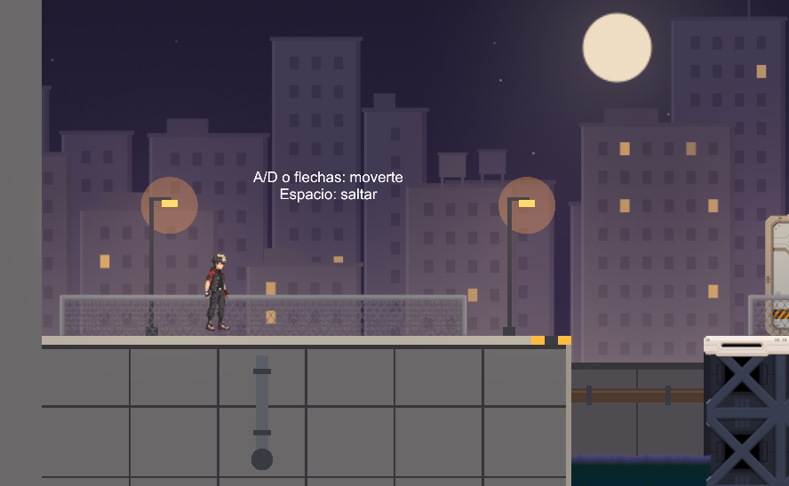
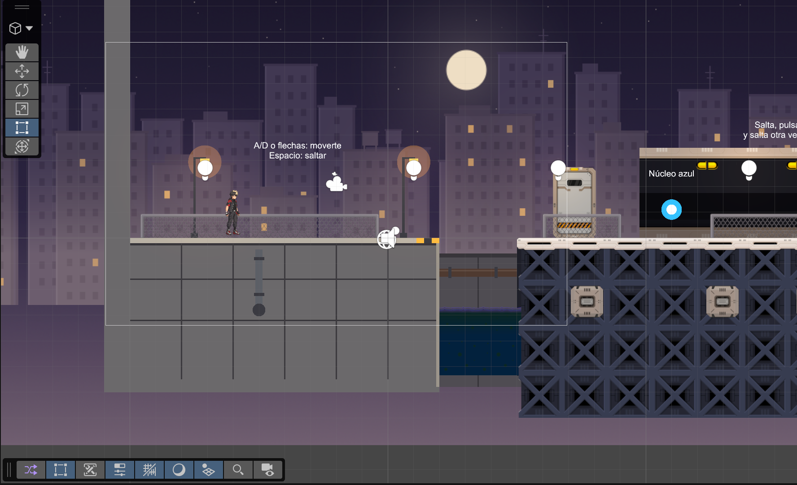
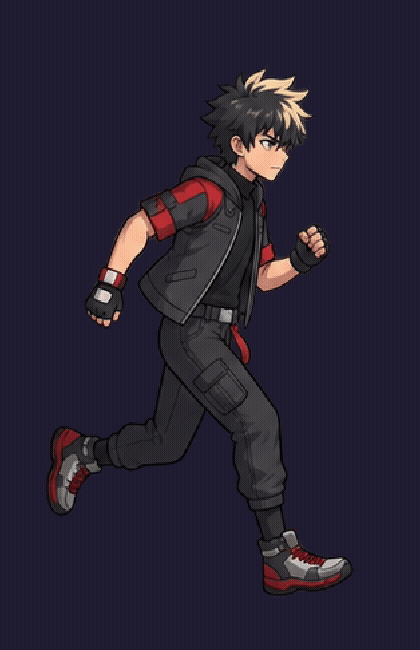

# Armor of the Rift

Armor of the Rift is a 2D action-adventure platformer set in a modern city invaded by magic. When the Dark Wizard King kidnaps his neighbors and forces them to build a portal to the Dark World, a boy who knows the neighborhood rooftops follows their captors to rescue them. Along the way, he recovers ancient suits of armor, each with an ability that changes how he moves through the city.

The playable canal prototype introduces the Blue Armor. Jump across the first gap, collect the Blue Core, then create a temporary ice step midair and jump from it to cross the wider gap.

## Gameplay

### Character movement

## Requirements

- [Unity Hub](https://unity.com/download)
- **Unity 6000.3.26f1** (Unity 6.3)
- Git, required by Unity Package Manager to fetch the Unity MCP package

The project uses the Universal Render Pipeline, Unity Input System, and Unity's 2D packages. Unity restores all packages automatically when the project is opened.

## Run the project

1. Clone or download this repository.
2. In Unity Hub, select **Add > Add project from disk** and choose the repository folder.
3. Open the project with **Unity 6000.3.26f1**.
4. Wait for Unity to import the assets and restore the packages.
5. Open `Assets/Scenes/CanalPrototype.unity`.
6. Press **Play**.

## Controls

| Action | Keyboard / Mouse | Gamepad |
| --- | --- | --- |
| Move | `A` / `D` or arrow keys | Left stick |
| Jump | `Space` | South button |
| Attack | `J`, `Enter`, or left click | West button |
| Create ice step | `E` | — |

## Build

Open **File > Build Profiles**, choose the target platform, add `Assets/Scenes/CanalPrototype.unity` to the scene list if needed, and select **Build**.
